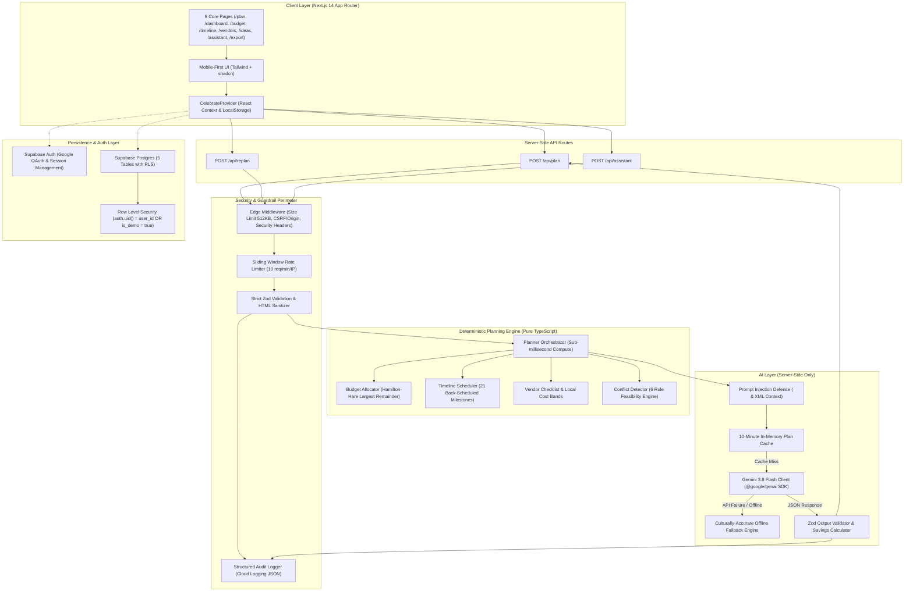

# CelebrateAI System Architecture

CelebrateAI is a full-stack generative celebration and event planner engineered with a strict **Deterministic Planning First** paradigm. GenAI is leveraged exclusively for creative and contextual personalization (themes, menus, risk mitigation, grounded chat) while all mathematical budgets, calendar dates, vendor booking deadlines, and feasibility constraints are strictly enforced by a deterministic engine.

---

## High-Level Architecture Diagram

---

## Core Architectural Pillars

### 1. The Deterministic Planning Engine
All facts are single-source-of-truth mathematical calculations:
- **Budget Allocation (`budget.ts`)**: Implements the **Hamilton-Hare (Largest Remainder) Method**. All allocations are guaranteed to be positive integers summing exactly to `totalBudget`. Enforces a minimum 10% contingency reserve (12% for outdoor events).
- **Timeline Back-Scheduling (`timeline.ts`)**: Computes 21 chronological milestones backwards from `eventDate`. Proportionally compresses milestones for short-notice events (<30 days). Due dates are guaranteed to be $\le \text{eventDate}$. Automatically flags overdue tasks as "Do Now".
- **Vendor Checklist (`vendors.ts`)**: Maps essential vendors according to city cost tiers (Tier 1 Bengaluru/Mumbai/Delhi, Tier 2, Tier 3) with target booking deadlines, key interview questions, and direct Google Maps query URLs.
- **Feasibility Engine (`feasibility.ts`)**: Evaluates 6 critical conflicts:
  1. `budget_too_low`: Total budget below per-guest minimum.
  2. `venue_deadline`: Event less than 30 days away without venue booked.
  3. `caterer_invitation_order`: Catering finalized after invitation mail-out.
  4. `due_date_congestion`: More than 3 tasks due on the exact same date.
  5. `missing_accessibility`: Missing ramps/seating when elderly or disabled guests attend.
  6. `outdoor_weather_risk`: Outdoor event without rain buffer contingency.

### 2. GenAI Integration Philosophy
Google Gemini (`gemini-3.8-flash` via `@google/genai`) is treated strictly as an **untrusted creative enrichment worker**:
- **Prompt Injection Defense**: User-supplied text (`title`, `specialRequests`, chat messages) is HTML-sanitized and isolated within `<untrusted_user_text>` tags. System instructions explicitly command the model to ignore any instructions inside those tags.
- **Fixed Fact Context**: A compact `<computed_plan>` XML document is fed to the model with the directive: *"These computed facts are fixed. Do not change amounts, dates, deadlines, or calculations. Use them only to personalize recommendations."*
- **Strict Structured Outputs**: Output schema enforces exact JSON structures using the official `@google/genai` `Type` enum.
- **Server-Side Validation & Savings Clamping**: All returned savings percentages are clamped between 0% and 30%. Unknown categories are rejected. Rupee savings amounts are computed by the server from actual budget lines—Gemini is never allowed to calculate currency figures.
- **Graceful Offline Degradation**: If `GEMINI_API_KEY` is absent, throttled (429), or unavailable, CelebrateAI automatically loads high-fidelity culturally grounded fallback templates labelled `"AI offline mode"`.

### 3. Security & Isolation Model
- **Zero Client Key Exposure**: `GEMINI_API_KEY` and `SUPABASE_SERVICE_ROLE_KEY` are strictly server-side environment variables. No client bundle ever receives them.
- **Next.js Middleware Guardrails**:
  - Rejects request payloads $> 512\text{ KB}$ (`413 Payload Too Large`).
  - Blocks cross-origin state-changing mutations (`sec-fetch-site: cross-site`).
  - Injects defense-in-depth HTTP headers: Strict Content Security Policy (CSP), HSTS, `X-Content-Type-Options: nosniff`, `X-Frame-Options: DENY`, `Referrer-Policy`, and `Permissions-Policy`.
- **Database Row-Level Security (RLS)**:
  - Public demo events (`is_demo = true`) are accessible to unauthenticated guests.
  - User-created events are strictly partitioned: `auth.uid() = user_id`.
- **Audit Logging**: Every plan generation, replan, and grounded assistant interaction is logged as structured JSON to stdout for Google Cloud Logging, with IP addresses automatically masked for privacy compliance.
