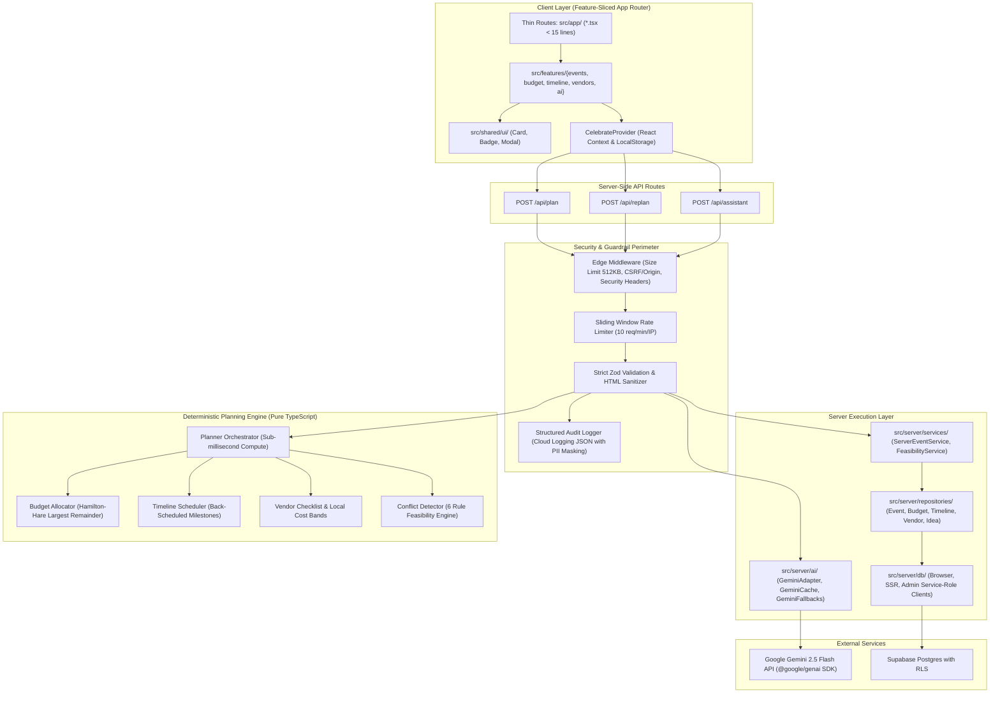

# CelebrateAI System Architecture

CelebrateAI is a full-stack generative celebration and event planner engineered with a strict **Deterministic Planning First** paradigm. GenAI is leveraged exclusively for creative and contextual personalization (themes, menus, risk mitigation, grounded chat) while all mathematical budgets, calendar dates, vendor booking deadlines, and feasibility constraints are strictly enforced by a deterministic engine.

---

## 1. High-Level Architecture Diagram



---

## 2. Directory Layout & Layer Boundaries

```
src/
  app/                      # Routing layer only: Thin Server Components (<15 lines each)
    page.tsx                # Composes <LandingFeature />
    plan/page.tsx           # Composes <EventWizard />
    dashboard/page.tsx      # Composes <DashboardFeature />
    budget/page.tsx         # Composes <BudgetFeature />
    timeline/page.tsx       # Composes <TimelineFeature />
    vendors/page.tsx        # Composes <VendorsFeature />
    ideas/page.tsx          # Composes <IdeasFeature />
    assistant/page.tsx      # Composes <AssistantFeature />
    export/page.tsx         # Composes <ExportFeature />
    api/                    # RESTful endpoints with Zod validation & PII audit logging
  features/                 # Domain-driven feature modules
    events/                 # Event lifecycle, wizard, dashboard, export
    budget/                 # Budget allocations, donut charts, expense tracking
    timeline/               # Back-scheduling, milestones, gantt view, run sheet
    vendors/                # Category checklists, pricing tiers, maps search
    ai/                     # Themes, menus, risk mitigation, grounded chat
  server/                   # Isolated server execution
    db/                     # Supabase client, SSR server, admin service-role
    repositories/           # Event, Budget, Timeline, Vendor, Idea repositories
    services/               # ServerEventService, FeasibilityService
    ai/                     # GeminiAdapter, GeminiCache, GeminiFallbacks
  shared/                   # Cross-cutting foundational utilities
    ui/                     # Card, Badge, Modal
    lib/                    # AppError, ValidationError, RateLimitError, Logger
    config/                 # PLANNING_CONSTANTS
    types/                  # AsyncState<T>, Result<T, E>
```

---

## 3. Core Architectural Pillars

### 1. The Deterministic Planning Engine
All numerical and calendar facts are single-source-of-truth mathematical calculations:
- **Budget Allocation (`budget.ts`)**: Implements the **Hamilton-Hare (Largest Remainder) Method**. All allocations are guaranteed to be positive integers summing exactly to `totalBudget`. Enforces a minimum 10% contingency reserve (12% for outdoor events).
- **Timeline Back-Scheduling (`timeline.ts`)**: Computes 21 chronological milestones backwards from `eventDate`. Proportionally compresses milestones for short-notice events (<30 days). Due dates are guaranteed to be $\le \text{eventDate}$. Automatically flags overdue tasks as "Do Now".
- **Vendor Checklist (`vendors.ts`)**: Maps essential vendors according to city cost tiers (Tier 1 Bengaluru/Mumbai/Delhi, Tier 2, Tier 3) with target booking deadlines, key interview questions, and direct Google Maps query URLs.
- **Feasibility Engine (`feasibility.ts`)**: Evaluates 6 critical conflicts:
  1. `budget_too_low`: Total budget below per-guest minimum.
  2. `venue_deadline`: Event less than 30 days away without venue booked.
  3. `caterer_invitation_order`: Catering finalized after invitation mail-out.
  4. `due_date_congestion`: More than 3 tasks due on the exact same date.
  5. `missing_accessibility`: Missing ramps/seating when elderly or disabled guests attend.
  6. `outdoor_weather_risk`: Outdoor event without rain buffer contingency.

### 2. GenAI Integration & Grounding Rules (`src/features/ai/`)
- **Server-Side Only**: Gemini calls are executed strictly in server-side API routes via `@google/genai`. Zero browser credential exposure.
- **Injectable AI Adapter (`GeminiClientAdapter`)**: Owns SDK execution with configurable timeout race conditions, automatic single-attempt transient retry on 429/5xx, typed `GeminiApiError`/`RateLimitError` exceptions, and secret-safe structured logging. Accepts mock clients for isolated unit testing.
- **Orchestration Service (`GeminiService`)**: Manages 10-minute in-memory caching keyed on deterministic plan hashes (`createPlanCacheKey`), sliding-window rate limiting (10 req/min/IP), and multi-turn grounded assistant conversations.
- **Recommendation Service (`RecommendationService`)**:
  - Validates completions with Zod post-response schemas.
  - **Rejects phantom budget categories** that do not exist in the computed budget.
  - **Clamps savings percentages** to realistic `[0, 30]%` bounds.
  - **Computes exact monetary savings on the server** (`Math.round(alloc.amount * pct / 100)`). The LLM is never trusted with monetary arithmetic.
  - **Transforms day offsets** into deterministic calendar dates (`addDaysFormatted(eventDate, -offset)`).
  - Sanitizes and HTML-escapes all strings against XSS.
- **Versioned Grounded Prompts**:
  - `EVENT_PLANNER_PROMPT_VERSION = 'v1.2.0'`
  - `REPLAN_PROMPT_VERSION = 'v1.2.0'`
  - `ASSISTANT_PROMPT_VERSION = 'v1.2.0'`
  - User text encapsulated inside `<untrusted_user_text>` passive tags with immutable mathematical directives.
- **Strict JSON Schema**: Structured outputs are enforced with `responseMimeType: 'application/json'` and strict `responseSchema` specifications.
- **Fault-Tolerant Resilience**: Automatic fallback to rich cultural Bengaluru templates (Weddings, Birthdays, Community events) when Gemini is unconfigured, throttled, or offline.

---

## 4. Quality Gates & Enforcement

| Quality Gate | Standard | Status |
| :--- | :--- | :--- |
| **Type Safety** | `npx tsc --noEmit` (strict mode, 0 `any`) | Verified passing |
| **Linting** | `next lint` (0 warnings, 0 errors) | Verified passing |
| **Automated Tests** | `npx vitest run` (112 / 112 passing) | Verified passing |
| **Production Build** | `next build` (Standalone output, all 15 routes pre-rendered) | Verified passing |
| **Continuous Integration**| GitHub Actions CI (`.github/workflows/ci.yml`) | Verified active |
