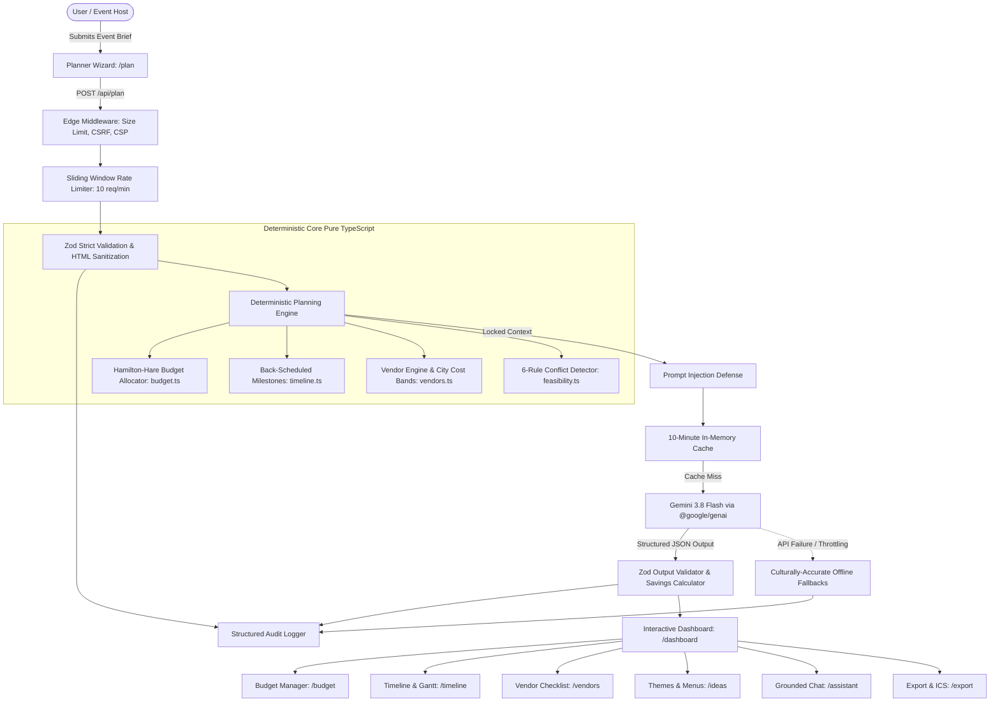

# CelebrateAI 🎉
**A Grounded GenAI Celebration & Event Planner for PromptWars Virtual Challenge 5**

> **“Plan every celebration with clarity, not chaos.”**  
> CelebrateAI turns your event brief into a budget that adds up, a timeline that works backwards from the big day, and a vendor checklist you can actually follow.

[](https://github.com/psryogeshwar-14/CelebrateAI/actions)
[](./LICENSE)
[](https://nextjs.org/)
[](https://ai.google.dev/)
[](https://cloud.google.com/run)
[](https://vitest.dev/)

---

## 🌐 Live Deployment & Repository

- **Live Application URL**: `https://celebrateai-placeholder-el.a.run.app` *(or your deployed Cloud Run service URL)*
- **Local Development URL**: `http://localhost:3000`
- **Health Check Endpoint**: `https://celebrateai-placeholder-el.a.run.app/api/health`
- **GitHub Repository**: `https://github.com/psryogeshwar-14/CelebrateAI`

---

## 📌 Problem Statement

Planning celebrations—such as weddings, milestone birthdays, and community festivals—is emotionally rewarding but operationally stressful:
1. **Mathematical Chaos**: Unrealistic vendor estimates, arbitrary percentages, and unbudgeted emergency costs lead to budget overruns.
2. **Reverse Scheduling Friction**: Most people plan forwards from today rather than backwards from the event date, discovering too late that caterers or venues must be booked 3 to 6 months in advance.
3. **Vendor Coordination Anxiety**: Hosts juggle disparate spreadsheets, vague quote ranges, and unstandardized interview questions without a single source of truth.
4. **Generic AI Hallucinations**: Prompting a vanilla LLM or chatbot with *"Plan my wedding for ₹15 Lakhs"* produces invented vendor numbers that don't total correctly, fictional calendar dates, and ungrounded advice.

**CelebrateAI solves this** through a strict separation of concerns: a **deterministic mathematical planning engine** computes all budgets, calendar milestones, booking deadlines, and feasibility warnings with zero hallucination risk, while **Google Gemini 3.8 Flash** is harnessed exclusively for grounded creative enrichment—personalized themes, regional dietary menus, contingency planning, and conversational guidance.

---

## 🏗️ Architecture & System Design



### The Architectural Separation of Concerns:
- **Deterministic Planning Engine**: Budget allocations, category percentages, contingency reserves ($\ge 10\%$, $\ge 12\%$ for outdoor), back-scheduled milestone dates, vendor booking deadlines, and feasibility warnings are 100% computed via pure TypeScript algorithms.
- **Gemini 3.8 Flash**: Never invents budget totals, dates, or calculations. Receives a compact, locked `<computed_plan>` XML context and strictly generates 3 personalized themes (with 4-color palettes), regional dietary menus, risk mitigation protocols, and answers to grounded assistant questions.
- **Prompt Injection Defense**: User text is sanitized and wrapped within `<untrusted_user_text>` tags with explicit model instructions to ignore instructions inside those tags.

---

## ⚖️ Why Deterministic Engine + Grounded Gemini Beats Pure Chatbots

| Planning Dimension | Pure LLM / Generic Chatbot | CelebrateAI Architecture |
|---|---|---|
| **Budget Sum Guarantee** | Often hallucinates line items that total 110%–140% of the stated budget. | **Hamilton-Hare Largest Remainder Method** guarantees every rupee adds up exactly to 100% of the total budget. |
| **Contingency Reserve** | Frequently forgets contingency or suggests arbitrary numbers (e.g., 2% or 25%). | Guaranteed minimum **10% contingency** (automatically raised to **12% for outdoor events**). |
| **Milestone Scheduling** | Generates arbitrary calendar dates without checking lead times or days remaining. | Back-schedules 21 milestones backwards from `eventDate`, compressing proportionally if $< 30$ days. |
| **Vendor Deadlines** | Provides vague advice (*"book early"*). | Computes concrete booking deadlines calibrated against city cost bands (Tier 1 vs Tier 2 vs Tier 3). |
| **Dietary & Accessibility** | Often overlooks edge constraints in freeform prose. | Form-enforced arrays passed into deterministic rules and Gemini prompts with strict validation. |
| **Network Failure Resiliency**| Fails completely with an error if the model API drops or rate limits. | Deterministic plan renders immediately; high-fidelity offline cultural templates populate if AI is unreachable. |

---

## 🎯 Feature Overview (9 Core Routes)

| Route | Page | Purpose & Capabilities |
|---|---|---|
| `/` | **Landing Page** | Value proposition hero, 3 pre-seeded Bengaluru demo loaders (Wedding, Birthday, Community), feature grid, and CTAs. |
| `/plan` | **Planner Wizard** | 3-step accessible form with progress bar, guest stepper, INR budget formatter, city chip selectors, and multi-select constraint tags. |
| `/dashboard` | **Command Center** | Real-time countdown timer, 5 KPI badges, tonal amber budget donut chart, Gantt overview, and instant replanning modal. |
| `/budget` | **Budget Manager** | Planned vs actual spend tracking, category breakdown table, inline/modal spend editor, contingency buffer status, and server-calculated rupee savings tips. |
| `/timeline` | **Timeline & Gantt** | 21 back-scheduled milestones with status filters (`All`, `Todo`, `Do Now (Overdue)`, `Completed`), owner filters (`Host`, `Family`, `Vendor`, `Planner`), and custom milestone creator. |
| `/vendors` | **Vendor Checklist** | Vendor pipeline cards, booking deadlines, quote vs budget band comparisons, status workflow (`Shortlisted` $\to$ `Quoted` $\to$ `Booked`), verification interview checklists, and 1-click Google Maps search. |
| `/ideas` | **AI Ideas & Run Sheet** | 3 personalized theme concepts with 4-color copyable swatches, regional banquet menus with dietary tags, risk mitigation matrix, and print-ready event-day run sheet. |
| `/assistant` | **Grounded Assistant** | Grounded chat interface with immutable mathematical context sidebar, prompt chips, and citation links. |
| `/export` | **Export & Share** | Printable one-sheet executive brief (`@media print`), `.ics` calendar sync download, and copyable WhatsApp family text summary. |

---

## 🤖 Gemini Prompt Design & Structured Validation

CelebrateAI interacts with Google Gemini 3.8 Flash through strict server-side API endpoints (`/api/plan`, `/api/replan`, `/api/assistant`).

### 1. Locked Mathematical Context
Gemini is passed an immutable, compact context block:
```xml
<computed_plan>
  <event_type>wedding</event_type>
  <city>Bengaluru (Tier 1)</city>
  <event_date>2026-12-15</event_date>
  <days_remaining>45</days_remaining>
  <guest_count>350</guest_count>
  <total_budget>₹25,00,000</total_budget>
  <budget_categories>
    <category name="venue" planned="₹7,00,000" percent="28%" />
    <category name="catering" planned="₹6,25,000" percent="25%" per_guest="₹1,785" />
    <category name="contingency" planned="₹2,50,000" percent="10%" />
  </budget_categories>
  <urgent_deadlines>
    <task name="Book Venue" due_date="2026-11-01" status="Do Now" />
  </urgent_deadlines>
  <dietary_requirements>Pure Vegetarian, Jain Available</dietary_requirements>
</computed_plan>
```

### 2. Strict Model Instructions
The system prompt explicitly commands the model:
> *"These computed numbers, dates, and deadlines are fixed mathematical facts. Do not invent, alter, or contradict them. Use them only to personalize creative themes, regional menus, risk mitigations, and savings recommendations."*

### 3. Native JSON Schema & Zod Validation
We utilize `responseSchema` and `responseMimeType: "application/json"` in `@google/genai`:
- **Themes**: 3 distinct concepts, each with a name, description, 4-hex color palette, decor ideas, and signature moment.
- **Menu**: Structured into courses (Welcome Drinks, Starters, Main Banquet, Desserts) with dietary tags adhering strictly to the user's constraints.
- **Risks**: Concrete operational failure modes with impact and mitigation protocols.
- **Savings Tips**: Percentage savings tips where the absolute rupee amounts are computed server-side (`planned_amount * percentage / 100`) rather than allowing the AI to calculate arithmetic.

---

## 🔒 Production Security Hardening

1. **Zero Secret Leakage**:
   - `GEMINI_API_KEY` and `SUPABASE_SERVICE_ROLE_KEY` reside strictly on the server.
   - Client bundles receive only public keys. Secrets are stored in Google Secret Manager and injected at runtime.
2. **Next.js Edge Middleware** (`src/middleware.ts`):
   - **Request Body Size Limit**: Incoming payloads $> 512\text{ KB}$ are rejected with `413 Payload Too Large`.
   - **CSRF & Origin Verification**: Verifies origins on state-changing API mutations.
   - **Production Headers**: Strict Content Security Policy (CSP), HSTS (`max-age=63072000; includeSubDomains; preload`), `X-Content-Type-Options: nosniff`, `X-Frame-Options: DENY`, `Referrer-Policy: strict-origin-when-cross-origin`, and `Permissions-Policy`.
3. **Zod Strict Validation**:
   - Every input schema enforces `.strict()` to reject unauthorized or injected parameter tampering.
4. **Structured Audit Logging** (`src/lib/logging/audit.ts`):
   - Logs plan generation, replanning, and assistant requests in structured single-line JSON format for Google Cloud Logging.
   - Automatically masks client IP addresses (`192.168.1.xxx`) for GDPR compliance.
5. **Generic Error Responses**:
   - Internal error handlers catch 500 exceptions and return sanitized messages, preventing stack traces or database connection strings from leaking to clients.

---

## ♿ Accessibility (a11y) Measures

CelebrateAI is engineered to comply with **WCAG 2.1 AA** standards:
- **Screen-Reader Table Alternatives**: The budget donut chart is paired with a hidden, fully accessible HTML table representation displaying category percentages, rupee allocations, and budget health.
- **Semantic HTML & Landmarks**: All pages utilize proper landmark regions (`<header>`, `<main>`, `<nav>`, `<aside>`, `<footer>`).
- **Form Controls & ARIA**:
  - Wizard step progress bar includes `role="progressbar"`, `aria-valuenow`, `aria-valuemin="1"`, `aria-valuemax="3"`, and descriptive `aria-label`.
  - All form fields feature explicit `<label>` tags with matching `htmlFor` and error regions linked via `aria-describedby`.
- **Keyboard Navigation**: Focus visible rings with high contrast amber accents (`focus-visible:ring-amber-500`) across all interactive cards, tabs, and modals.
- **Touch Targets**: Minimum touch target size $\ge 44\times 44\text{ px}$ for mobile and touchscreen usability.
- **Color Contrast**: All text elements meet or exceed the 4.5:1 contrast ratio against the warm neutral background (`#fafaf9`) and dark mode surfaces (`#1c1917`).

---

## 🧪 Testing & Quality Assurance

CelebrateAI includes a comprehensive suite of **112 unit, integration, and security tests across 18 test files** running on Vitest:

```bash
# Run complete test suite
npm run test

# Run tests with code coverage report
npm run test:coverage

# Run TypeScript static type checking
npx tsc --noEmit

# Run ESLint quality audit
npm run lint
```

### Test Suite Breakdown
- `src/lib/engine/budget.test.ts`: Hamilton-Hare exact allocation, positive integer guarantees, $\ge 10\%$ contingency.
- `src/lib/engine/timeline.test.ts`: 21 back-scheduled milestones, short-notice compression (<30d), overdue "Do now" tagging.
- `src/lib/engine/vendors.test.ts`: Booking deadlines, budget ranges, and Google Maps query links.
- `src/lib/engine/feasibility.test.ts`: Detection of all 6 operational conflict types.
- `src/lib/ai/gemini-mocked.test.ts`: Malformed Gemini output rejection, prompt injection defense, rate limiting, and grounded assistant responses.
- `src/lib/security/security-hardening.test.ts`: Zod strict schema rejection, 512 KB payload size enforcement, and audit log IP anonymization.
- `src/lib/supabase/auth-rls.test.ts`: Supabase service-role key protection and Row-Level Security policy verification.
- `src/app/api/health/route.test.ts`: GET `/api/health` status, HTTP 200, and non-caching headers.
- `src/test/integration.test.ts`: Full end-to-end plan generation, replanning, milestone completion, and export data flow.
- `src/test/a11y-smoke.test.ts`: Screen-reader table alternatives for charts, semantic labels, and focus indicators.

---

## 🚀 Google Cloud Run Deployment (`asia-south1`)

CelebrateAI is packaged with an optimized multi-stage `Dockerfile` (`node:20-alpine`, `tini` signal init, non-root user `nextjs:nodejs`) listening on `process.env.PORT`.

### 1. Authenticate and Set Project
```bash
gcloud auth login
gcloud config set project [YOUR_PROJECT_ID]
```

### 2. Automated One-Command Deployment
```bash
chmod +x ./scripts/deploy-cloud-run.sh
./scripts/deploy-cloud-run.sh [YOUR_PROJECT_ID]
```

### 3. Direct Step-by-Step CLI Commands
```bash
# A. Enable Cloud APIs
gcloud services enable run.googleapis.com artifactregistry.googleapis.com secretmanager.googleapis.com cloudbuild.googleapis.com --project=[YOUR_PROJECT_ID]

# B. Provision Secrets in Secret Manager
chmod +x ./scripts/setup-secrets.sh
./scripts/setup-secrets.sh [YOUR_PROJECT_ID]

# C. Submit Container Build
gcloud builds submit --project=[YOUR_PROJECT_ID] --tag gcr.io/[YOUR_PROJECT_ID]/celebrateai:latest .

# D. Deploy to Cloud Run (asia-south1)
gcloud run deploy celebrateai \
  --project=[YOUR_PROJECT_ID] \
  --image gcr.io/[YOUR_PROJECT_ID]/celebrateai:latest \
  --platform managed \
  --region asia-south1 \
  --allow-unauthenticated \
  --port 8080 \
  --min-instances 0 \
  --max-instances 3 \
  --memory 512Mi \
  --cpu 1 \
  --set-env-vars="NODE_ENV=production,PORT=8080,HOSTNAME=0.0.0.0" \
  --set-secrets="GEMINI_API_KEY=GEMINI_API_KEY:latest,NEXT_PUBLIC_SUPABASE_URL=NEXT_PUBLIC_SUPABASE_URL:latest,NEXT_PUBLIC_SUPABASE_ANON_KEY=NEXT_PUBLIC_SUPABASE_ANON_KEY:latest,SUPABASE_SERVICE_ROLE_KEY=SUPABASE_SERVICE_ROLE_KEY:latest"
```

---

## 📂 Repository File Structure

```
celebrate-ai/
├── .github/workflows/ci.yml         # GitHub Actions CI (Lint, Typecheck, Test, Build)
├── docs/
│   └── media/                       # Vector UI previews and diagrams
├── scripts/
│   ├── deploy-cloud-run.sh          # One-click Cloud Run deployment script
│   └── setup-secrets.sh             # Secret Manager provisioning script
├── src/
│   ├── app/
│   │   ├── api/
│   │   │   ├── assistant/route.ts   # Grounded Ask CelebrateAI assistant endpoint
│   │   │   ├── health/route.ts      # Cloud Run healthcheck endpoint (GET /api/health)
│   │   │   ├── plan/route.ts        # Plan generation endpoint with rate-limiting
│   │   │   └── replan/route.ts      # Plan recalculation endpoint
│   │   ├── assistant/page.tsx       # Grounded assistant chat page
│   │   ├── budget/page.tsx          # Budget & expense management page
│   │   ├── dashboard/page.tsx       # Celebration command center
│   │   ├── export/page.tsx          # Print brief, .ics sync, and WhatsApp export
│   │   ├── ideas/page.tsx           # Themes, regional menus, and run sheet
│   │   ├── plan/page.tsx            # 3-step accessible planner wizard
│   │   ├── timeline/page.tsx        # Milestone timeline & Gantt page
│   │   ├── vendors/page.tsx         # Vendor booking checklist & interview questions
│   │   ├── error.tsx                # Custom 500 error boundary
│   │   ├── global-error.tsx         # Global server error fallback
│   │   ├── not-found.tsx            # Branded 404 page
│   │   └── page.tsx                 # Landing page with demo triggers
│   ├── components/
│   │   ├── dashboard/               # Donut chart, KPI cards, modals, Gantt view
│   │   └── layout/                  # Navbar, EventSubNav, Footer
│   ├── lib/
│   │   ├── ai/                      # Gemini client, prompt templates, Zod validation
│   │   ├── engine/                  # Deterministic budget, timeline, vendor, feasibility
│   │   ├── logging/                 # Structured audit logger with IP masking
│   │   ├── repositories/            # Supabase Postgres data access layer
│   │   ├── security/                # Security tests and rate limiter
│   │   ├── services/                # Business domain service layer
│   │   ├── supabase/                # Supabase client, server, admin, RLS tests
│   │   └── utils/                   # Deterministic math, INR formatting, date utils
│   └── middleware.ts                # Edge size limiting, CSRF check, security headers
├── Dockerfile                       # Node 20 Alpine multi-stage standalone runner
├── ARCHITECTURE.md                  # Comprehensive architectural specification
├── PROMPTS.md                       # Complete Gemini prompt engineering rationale
├── CHANGELOG.md                     # Semantic version history
└── README.md                        # Project documentation & setup guide
```

---

## 🎟️ Pre-Seeded Bengaluru Demo Events

CelebrateAI requires **no login or credentials to explore in demo mode**:
1. **Heritage Kannada Wedding**:
   - *Hosts*: Ananya & Vikram | *Venue*: Palace Grounds, Bengaluru
   - *Details*: 350 guests, ₹25,00,000 budget, traditional Udupi banquet feast, Hoysala stone-carved mandap decor, and live Nadaswaram music.
2. **Cyberpunk Rooftop Birthday**:
   - *Host*: Rohan (30th Birthday) | *Venue*: Indiranagar 100 Ft Road
   - *Details*: 50 guests, ₹1,50,000 budget, local craft microbrewery kegs, retro arcade tournament, and neon photo booth.
3. **Sustainability Community Fair**:
   - *Organizers*: HSR Layout Resident Welfare Association | *Venue*: Sector 2 BBMP Park
   - *Details*: 600 guests, ₹3,50,000 budget, zero-plastic millet culinary stalls, solar sound stage, and 600 native sapling return gifts.

---

## 🗺️ Future Roadmap

- [ ] **Multi-Currency Engine**: Support for USD (`$`), EUR (`€`), and GBP (`£`) with regional vendor cost tiering for international destinations.
- [ ] **Vendor Invoice OCR**: Uploading PDF and image vendor quotes to parse line items automatically via Gemini multimodal vision.
- [ ] **Multi-Collaborator Family Portal**: Real-time Supabase presence allowing family members to vote on themes and assign checklist tasks.
- [ ] **Two-Way WhatsApp Bot**: Automated RSVP updates and deadline reminders powered by Twilio and Gemini.

---

## 📜 License

Built for **PromptWars Virtual Challenge 5**. Distributed under the [MIT License](./LICENSE).
