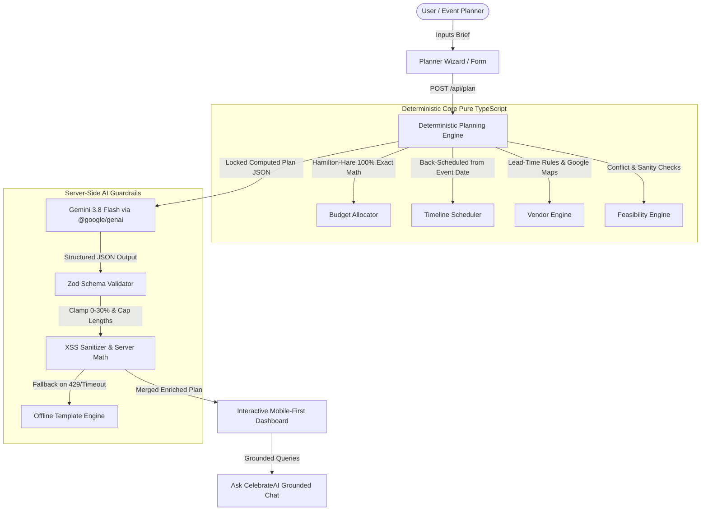

# CelebrateAI 🎉
**GenAI-Powered Celebration & Event Planner for PromptWars Virtual Challenge 5**

> **“Plan every celebration with clarity, not chaos.”**
> CelebrateAI turns your event brief into a budget that adds up, a timeline that works backwards from the big day, and a vendor checklist you can actually follow.

---

## Architecture Overview

CelebrateAI enforces a strict **separation between deterministic planning facts and GenAI creative recommendations**:



### The Cardinal Rule:
- **Deterministic Planning Engine**: Budget calculations, category percentages, contingency reserves, back-scheduled timeline dates, vendor deadlines, and feasibility warnings are 100% computed via pure TypeScript algorithms.
- **Gemini 3.8 Flash**: Never invents budget totals, dates, or calculations. Receives a fixed, compact `<computed_plan>` context and strictly generates personalized theme concepts (with 4-color palettes), regional menus respecting dietary constraints, risk matrices, and grounded assistant responses.

---

## Tech Stack

- **Frontend**: Next.js 14 App Router, TypeScript, Tailwind CSS
- **Design System**: Warm neutral background (`#fafaf9`), ink text (`#1c1917`), saffron-gold accent (`#d97706`), subtle shadows, rounded-2xl cards, dark mode support
- **AI**: Google Gemini API via official `@google/genai` SDK (`gemini-3.8-flash`) with strict `responseJsonSchema`
- **Database**: Supabase Postgres with Row-Level Security (RLS) policies
- **Auth**: Google Sign-In via Supabase Auth
- **Testing**: Vitest (93 tests covering deterministic math, schemas, AI validation, and API routes)
- **Deployment**: Google Cloud Run (multi-stage Docker container with Next.js standalone output)

---

## Key Features

1. **Deterministic Budget Allocator**:
   - Zero lost rupees/paise via the **Hamilton-Hare (Largest Remainder) Method**.
   - Mandatory **10%+ contingency reserve** (12%+ for outdoor events).
   - Dynamic adjustments for city cost tiers (Tier 1 vs Tier 3), guest counts, venue types (indoor vs outdoor), and styles (budget, balanced, premium).
   - Per-guest catering feasibility warnings against city-tier baselines.
2. **Back-Scheduled Timeline**:
   - 21 milestones scheduled backwards from `eventDate`.
   - **Proportional Timeline Compression**: For short-notice events (< 30 days), all milestones compress into the available window without falling in the past or after the event.
   - Overdue tasks automatically tagged as **"Do now"**.
3. **Vendor Procurement Checklist**:
   - Category-specific booking deadlines and estimated budget bands.
   - Specific, hard-hitting questions to ask before signing contracts.
   - Direct Google Maps search links: `https://www.google.com/maps/search/?api=1&query={vendor}+in+{city}`.
4. **Feasibility Conflict Engine**:
   - Detects: Budget too low for guest count, venue booking overdue, caterer scheduled after invitations, task congestion (> 3 tasks on one day), missing accessibility for elderly guests, and outdoor rain exposure.
5. **Grounded "Ask CelebrateAI" Assistant**:
   - Answers questions strictly using your locked budget and timeline.
   - Built-in prompt injection defense that politely rejects off-topic queries and prevents instruction tampering.
   - Returns answer plus 3 relevant follow-up questions and fact citations.
6. **Export & Sharing**:
   - Print-friendly event brief (`@media print` clean layout).
   - RFC 5545 `.ics` calendar export for Google Calendar, Apple Calendar, and Outlook.
   - 1-click copyable WhatsApp / SMS family group summary.

---

## Bengaluru Demo Events Included

CelebrateAI comes pre-seeded with 3 realistic scenarios ready to explore:
1. **Wedding**: *Ananya & Vikram's Heritage Kannada Wedding* (Palace Grounds, 350 guests, ₹25,00,000, Udupi plantain leaf feast, Hoysala mandap, live Nadaswaram).
2. **Birthday**: *Rohan's 30th Cyberpunk Rooftop Bash* (Indiranagar 100 Ft Rd, 50 guests, ₹1,50,000, craft microbrewery kegs, retro arcade tournament, neon photobooth).
3. **Community Event**: *HSR Layout Sustainability & Green Habitat Fair* (Sector 2 BBMP Park, 600 guests, ₹3,50,000, zero-plastic millet fair, solar sound stage, 600 native sapling gifts).

---

## Local Development Setup

### 1. Prerequisites
- Node.js 20+
- npm or pnpm
- Google Gemini API Key (from [Google AI Studio](https://aistudio.google.com/))
- Supabase project (optional for local in-memory demo exploration, required for live DB persistence)

### 2. Installation
```bash
git clone https://github.com/your-username/celebrate-ai.git
cd celebrate-ai
npm install
```

### 3. Environment Variables
Copy `.env.example` to `.env.local`:
```bash
cp .env.example .env.local
```
Fill in your credentials:
```env
GEMINI_API_KEY=your_gemini_api_key_here
NEXT_PUBLIC_SUPABASE_URL=https://your-project.supabase.co
NEXT_PUBLIC_SUPABASE_ANON_KEY=your_supabase_anon_key
SUPABASE_SERVICE_ROLE_KEY=your_supabase_service_role_key
```

### 4. Running the Development Server
```bash
npm run dev
```
Open [http://localhost:3000](http://localhost:3000) in your browser.

---

## Testing

Execute the Vitest test suite (93 unit and integration tests):
```bash
npm run test
```

Test coverage includes:
- `budget.test.ts`: Hamilton-Hare exact allocation, positive integer guarantees, contingency >= 10%.
- `timeline.test.ts`: 21 back-scheduled milestones, short-notice compression (<30d), overdue "Do now" tagging.
- `vendors.test.ts`: Booking deadlines, budget ranges, and Google Maps query links.
- `feasibility.test.ts`: Detection of all 6 operational conflict types.
- `gemini-client.test.ts`: Sliding-window rate limiting (10 req/min), 10-minute caching, prompt injection defense, and offline fallback.
- `route.test.ts`: API route integration testing for `/api/plan`, `/api/replan`, and `/api/assistant`.

---

## Google Cloud Run Deployment

CelebrateAI is packaged with an optimized multi-stage `Dockerfile` and Next.js standalone output.

### 1. Authenticate with Google Cloud
```bash
gcloud auth login
gcloud config set project [YOUR_PROJECT_ID]
```

### 2. Enable Required APIs
```bash
gcloud services enable \
    run.googleapis.com \
    artifactregistry.googleapis.com \
    secretmanager.googleapis.com \
    cloudbuild.googleapis.com
```

### 3. Build Container via Google Cloud Build
```bash
gcloud builds submit --tag gcr.io/[YOUR_PROJECT_ID]/celebrate-ai:latest
```

### 4. Deploy to Cloud Run
```bash
gcloud run deploy celebrate-ai \
    --image gcr.io/[YOUR_PROJECT_ID]/celebrate-ai:latest \
    --platform managed \
    --region us-central1 \
    --allow-unauthenticated \
    --port 8080 \
    --memory 1Gi \
    --cpu 1 \
    --set-env-vars="NODE_ENV=production,GEMINI_API_KEY=[YOUR_KEY],NEXT_PUBLIC_SUPABASE_URL=[YOUR_URL],NEXT_PUBLIC_SUPABASE_ANON_KEY=[YOUR_KEY]"
```

---

## License

Built for **PromptWars Virtual Challenge 5**. MIT License.
